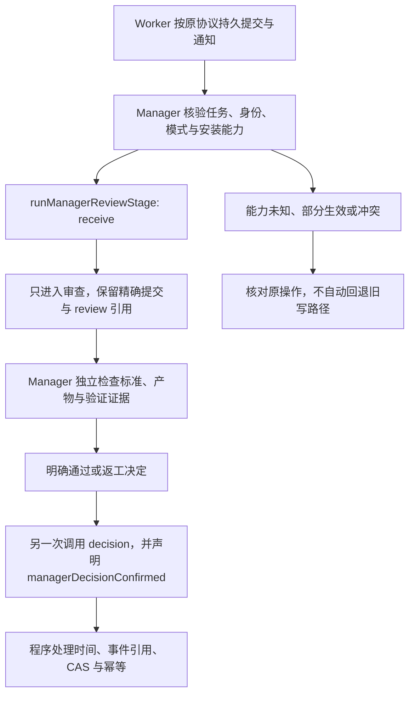

# Manager 新旧操作入口统一

设计日期：2026-11-06；归档日期：2026-11-07。已随 `29cfbc4` 进入主线。本文整理已确认并实施的方案，不新增 Runtime 接口或 Worker 步骤。

## 问题与目标

固定的 Manager 操作程序已经存在，但 Skill 的完成通知条目和收件说明仍直接指向旧 receive-submission 路径。模型可能回到手写业务事件、拼 UTC 时间和引用再 apply 的流程，增加参数错误与协商调用。目标是在已有授权检查点统一正常入口，让模型负责审查判断，程序负责确定性协议处理。

## 正常流程

receive 不代表验收通过。decision 必须绑定刚接收或从原审查恢复的精确提交与审查事件，不能把接收与批准合并为自动动作。现有 FIFO、占用、模式与授权保持不变。

## 三处规则修改

| 文件 | 改动 |
| --- | --- |
| [SKILL.md](../../skills/manager-session/SKILL.md) | 完成/提交条目保留 Worker 通知路由，将 Manager 收件和决策指向统一监督入口 |
| [completion-notification.md](../../skills/manager-session/references/completion-notification.md) | 收件说明不再直接推荐旧写路径，强调接收只启动审查 |
| [manager-supervision.md](../../skills/manager-session/references/manager-supervision.md) | 指定正常 receive/decision 调用、独立验收与旧版本兼容边界 |

现有 [manager-operations](../manager-operations.md) 实现保持不变；此次入口统一没有改通知 prompt、去重协议、MCP schema、状态机或 Worker 提交/恢复逻辑。

## 兼容与回退

旧入口用于已核验旧安装及原操作恢复，不是新入口失败后的自动备选。缺能力、unknown、部分效果或冲突时先核对精确操作；不得重做收件/决定、换发送者或盲目重发。在途任务不因规则重读而迁移或重做。

本地采用三文件定向补丁：保留当前安装其他差异、完整备份并演练回退；遇到后续未知改动则在写入前停止。代码回退不删除或撤销已经发生的业务与审计事实。源码合并不代表重新安装。

## 验收与观察

- 路由契约、收件/决定、时间格式、幂等、失败恢复、双 Worker 及可选 PDC 等候选回归 98 项通过。主线整合后完整回归 Node 719 项、Python 270 项通过。
- 独立检查 Worker 通知正文、失败恢复尾部、共享规则非目标段和运行代码未被本次入口修改改变。
- 三位 Manager 已在 11 月 6 日实际读取并确认三个安装文件哈希匹配；这只证明加载。
- 后续自然任务观察正常入口采用、手写事件和参数重试、收件到审查决定的时间，以及 Worker 是否增加调用。停止/空闲等待单列，缺失数据记 unknown。
- 不从安装成功或测试通过推断 Token/交付时间改善，不把业务构建时间变化归因于本规则。

当前验证与本地证据边界见[主线收口说明](../optimization/manager-optimization-rollup-20261107.md)；原始回执和日志仅本地保存。
