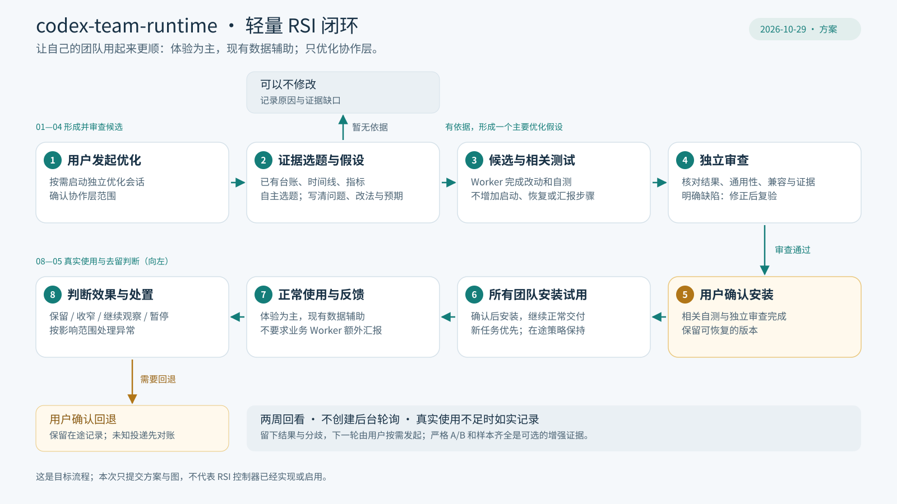

# codex-team-runtime：轻量 RSI 闭环方案

日期：2026-10-29  
状态：用户已确认的方案；本次仅保存文档和流程图，不开发、安装或启用 RSI 功能。

> 用户正常使用团队；独立优化会话负责找问题、形成候选、检查效果。用户体验决定是否值得保留，现有数据帮助发现误判和退化。

RSI 在这里指团队协作软件对自身 Skill、流程与确定性工具接口的持续改进，不涉及模型权重训练或无限递归自治。第一阶段先把用户自己的多个团队打磨好，机制保持通用。

## 与早期方案的关系

本文件是当前个人使用场景的推进口径。它补充并调整 [2026-09-19 的 RSI 设计](team-rsi.md) 中较严格的实验要求，不覆盖历史记录或回写既有观测结论；当前能力仍应按实际代码和安装版本核实。

| 项目 | 本次确认 |
| --- | --- |
| 主要目标 | 优先缩短完整交付时间，降低协作等待和用户纠偏负担 |
| 效果判断 | 使用体验为主，现有运行数据辅助；结论强度与证据相称 |
| 对照要求 | 严格 A/B、完整跨团队样本是增强证据，不是每次保留版本的必备条件 |
| 优化投入 | 暂不设预算前置审批，不设“10 分钟 / 3 个任务”等探索上限；成本照实记录 |
| 试用方式 | 相关自测与独立审查完成，用户确认后所有团队一起安装试用 |
| 观察节奏 | 两周作为回看节点；发现问题及时处理，证据不足由用户决定继续观察 |
| 不变边界 | 不降低验收要求、不增加 Worker 负担、保留证据与回退能力 |

本方案仍承接 [North Star](../../NORTHSTAR.md) 的质量、可观察性和持续改进方向。优先交付时间是当前轻量迭代的取舍，不等于已证明总 Token 或费用下降，也不修改已安装的 Skill、模型配置和授权机制。

## 1. 目标与优化范围

第一目标是缩短**一个完整需求从提出到最终整体验收的时间**。多个 Worker 的局部提速，只有改善完整交付，才算改善主要目标。

同时观察用户是否更少等待、催促、反复确认和纠正协作问题。质量约束继续保留，不能靠跳过审查、提前验收或隐藏失败获得好看的耗时。

允许优化派发、澄清、交接、状态同步、上下文恢复、审查组织和返工协调。规则精简、机械步骤合并、通用 Runtime 编排和结果投影都属于候选方向。

- 按依赖关系、资源冲突、证据完整性等通用任务特征选择流程，不按团队名称或业务标识写特例。
- 编译、打包、测试执行或业务算法自身的瓶颈可以被指出，交给对应项目处理；RSI 不自动修改业务执行代码。
- 不增加 Worker 启动、恢复、必读材料、必需 MCP 调用或额外汇报步骤。
- 允许验证后退役冗余流程和旧机制；保留历史可解释性，并处理在途依赖与回退。
- 没有充分依据时，可以交付“不建议修改”及原因。

## 2. 职责分工

| 参与者 | 职责 |
| --- | --- |
| 用户 | 发起优化，确认安装，提供使用反馈，决定继续观察及是否回退 |
| 独立优化会话 | 按需汇总跨团队证据，自主选题，记录假设和收益目标，组织候选、审查与效果分析 |
| 开发 Worker | 在授权范围内完成候选、相关测试和真实交付证据 |
| 独立评审者 | 核对正确性、通用性、兼容性及证据是否支持结论；不以作者自评替代审查 |
| Runtime 程序 | 采集现有事实、计算指标、执行确定性校验和已批准的流程规则 |
| 业务 Manager / Worker | 继续正常交付，不承担额外 RSI 汇报工作 |

优化会话独立于业务 Manager，按用户请求运行，不成为长期轮询团队的后台 Agent。

程序负责确定性事务；LLM 负责理解原因、提出改法和审查证据。Runtime 不改写原始需求、提交内容或验收语义。原业务台账和身份登记表继续保持各自权威，RSI 不建立第二个业务调度器。

## 3. 最小闭环

[查看 SVG 原图](../assets/team-rsi-lightweight-20261029.svg) · [Mermaid 流程源](../assets/team-rsi-lightweight-20261029.mmd)

图是目标流程，不是已部署的自动控制器。按编号 1—8 阅读：上排从左到右，下排从右到左。没有依据可以不修改；测试失败或发现明确缺陷时，先修正复验，不能跳过审查直接安装。SVG 用于 GitHub 展示，Mermaid 文件保留相同的流程关系，后续修改应同步维护。

| 阶段 | 最少需要做什么 | 产出 |
| --- | --- | --- |
| 找问题 | 看已有时间线、指标、交付和审查记录，定位协作瓶颈 | 有来源的问题及证据缺口 |
| 定方向 | 用几句话记录问题、准备怎么改、希望改善什么 | 一个主要优化假设及适用条件 |
| 做候选 | Worker 开发，完成相关测试和独立审查 | 可审查的改动、结果及回退位置 |
| 安装试用 | 用户确认后，所有团队一起安装，继续正常任务 | 候选版本、试用范围及启用记录 |
| 看效果 | 汇总用户感受，用现有记录校准并检查退化 | 改善、异常和未确定事项 |
| 作决定 | 保留、收窄范围、继续观察、暂停或确认回退 | 简洁结论及下一步 |

优化会话可在已确认的协作层范围内自主选择瓶颈并完成候选，不要求用户逐项批准选题、工具调用和常规修正。**安装仍由用户确认；这份设计文档本身不授予安装或操作业务团队的权限。**

每轮围绕一个主要优化假设，必要的配套改动可以属于同一候选。实施前记下目标与评价口径，不在看到结果后换一套有利标准。没有统一的提速百分比，也不要求先取得严格因果证明才能开始试用。

明确错误修正后复验；能补充验证的分歧用证据判断；暂时无法确认的收益或取舍，保留双方依据交给用户，不靠反复讨论强求一致。

## 4. 轻量效果判断

| 方面 | 关注的问题 |
| --- | --- |
| 使用体验 | 是否更快拿到结果，少等几轮，少催促、少纠正？ |
| 已有数据 | 完整任务耗时、协作等待、模型调用和总 Token 有没有明显变化？ |
| 正确性与稳定性 | 有没有漏报、重复派发、错误投递、跳过验收或新增恢复步骤？ |
| 通用性 | 哪类任务改善、无变化或持续退化；适用条件能否用通用特征描述？ |

- 能可靠隔离时做同期对照；不能隔离时使用前后观察，并说明任务难度、模型、缓存、环境等混杂因素。
- 同一个业务任务正常执行一次，不为凑对照重复业务操作。
- 跨团队样本用于增强判断，不要求每次样本齐全才能保留版本。
- 某类任务出现可重复、可归因的持续退化时，收窄适用范围，不能用总体平均改善掩盖。
- 数据缺失写 `unknown`，不补零、不估算成确定结果，也不要求 Worker 为补齐数据多做一步。
- 并行 Worker 历时不能直接相加当作完整交付时间。用户决策等待单独标注，不悄悄从总时间中扣除。
- 中断、失败、范围变更和返工保留并注明；不能删除不利样本。返工少也不自动代表质量更好。
- 安装、实际加载、自然采用和使用效果分开记录；磁盘文件更新不等于所有会话已经采用新策略。

可以得出“用下来更顺，已有记录支持改善趋势”，无需包装成严格证明的提速比例。用户感受与数据不一致时，列出分歧，而不是调整口径让候选过关。明确的正确性或稳定性问题仍需处理，不能被主观提速抵消。

### 两笔成本账

1. **交付成本**：完整任务中 Manager、Worker、Liaison、Reviewer 等的总消耗。先按同类完整任务总 Token 增幅 **30% 的初始上限**对照；超出时明确报告，由用户决定取舍，不自行把上限改宽。
2. **优化成本**：RSI 的分析、开发、测试和评审投入单独记录，计入系统周期总账；暂不设预算前置门槛或探索时限。

能取得时分别保留 cached input、uncached input、output 和实际费用；工具次数、输出字节、Token 与费用不能互相替代。缺少可比基线时，不计算一个看似精确的增幅。

## 5. 安装、任务边界与观察

相关自测和独立审查完成后，由用户确认安装，所有团队一起试用。仅安装可审查、可验证、可回退的候选，不为每个团队重复制造审批步骤。

新规则优先用于新任务。同一任务保持既定协作策略；更新若无法兼容在途任务，就安排在受影响任务收口后安装，不强行中途切换。

不为获得严格对照先建设复杂的双版本实验平台。若以后采用稳定组与候选组，必须核实实际隔离能力，不能只在台账里写一个版本标签就声称完成 A/B。涉及共享 Manager 上下文或 Skill 时，尤其需要说明相互影响。

**两周作为一次回看节点，不是强制等待期，也不因到期自动回退。** 明显问题及时处理；使用次数少或证据不足时如实记录，由用户决定是否继续观察。用户一句“更顺了”“还是卡在验收”“感觉更慢”，就可以成为分析线索，不要求填写评估表。

不因观察窗口创建后台 LLM 轮询、定时唤醒或常驻优化 Agent。正式团队的既有工作授权、身份边界、占用保护和独立验收继续适用。

## 6. 暂停与回退

| 情况 | 处置 |
| --- | --- |
| 明确局限于某类通用任务特征 | 暂停对应候选路径，检查其他已验证路径是否可继续 |
| 重复派发、身份错配、跳过验收等共同约束被破坏 | 暂停整个候选承接新操作 |
| 影响范围不清楚 | 先暂停候选，诊断后再收窄 |
| 普通业务执行失败 | 先判断原因，不直接归咎于 Runtime |

暂停不等于代码回退，也不等于强制中断 Worker。在途记录保留，未知投递先对账，不自动重发、重新领取或迁移到旧流程。**代码回退由用户确认。**

退役旧机制需要验证历史记录仍可解释、在途任务已处理且回退路径清楚。退役执行路径不代表删除业务历史、原始证据或备份。

## 7. 证据来源与最少记录

默认顺序：

**现有台账与事件 → 时间线与指标 → 任务卡、提交和验收证据 → 必要的局部对话。**

原因仍不清楚时，独立优化会话可以在授权范围内读取具体任务、具体时间段的少量对话，记录读取目的。原始内容保留在原位置，以引用关联；不复制整套聊天历史，不保存隐藏推理，不无授权扫描其他任务。

每轮只保留三类必要材料：

1. **优化记录**：问题、假设、适用条件、基线和候选版本。
2. **候选证据**：实际改动、相关测试、独立审查、回退位置。
3. **使用结论**：用户反馈、数据佐证、异常、未确定事项和最终决定。

成功与失败都保留简短结论，减少重复尝试。条件发生变化、有新依据时，可以重新验证过去的假设；不把旧结论固化为永久禁区。

复用现有 [任务时间线](task-timeline.md)、[Team Metrics](../team-metrics.md)、[优化说明](../optimization/README.md) 和 [实验台账](../optimization/team-flow-experiments.md)，暂不以外部 Trace/Eval Runtime 或新平台为前提。

## 8. 第一阶段完成标准

选一个真实协作瓶颈，完成一次从证据选题、候选测试、用户确认安装，到真实使用和去留判断的完整过程。

合格结果可以是保留、收窄范围、继续观察、回退，也可以是不修改。衡量的是这套闭环是否帮助用户改善自己的工具，而不是改动次数、评估报告长度或制造更多 Agent 调用。

本文件定义后续方向与判断口径，不宣称自动选题、任务版本隔离、实验分组、自动暂停或完整 RSI 控制器已经实现。本次文档与图的提交不修改功能代码、Skill、已安装 Runtime、团队状态或定时器。
