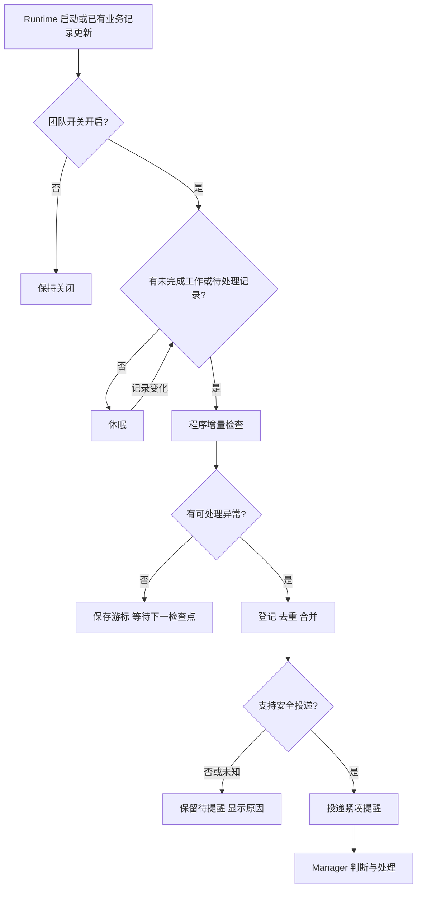

# Watchdog：程序巡检与异常提醒

日期：2026-11-14。状态：设计方向已确认，文档入库；未开发、未安装、未启用。只划分 P0/P1，P1 不纳入第一批实现。

## 核心目标

**不打断正在执行的任务、不增加 Worker 启动和恢复负担，发现协作链路中尚未处理的问题，并可靠地提醒 Manager。**

默认开启程序巡检，无未完成工作时休眠，无异常不唤醒 LLM。程序确认可验证的记录与状态，Manager 判断原因、下一步和验收结果。成功标准是减少遗漏与人工催问，而不是增加巡检次数。

不做自动派工、重派、取消、批准或业务状态修复；不读取完整 Worker 对话作常规巡检；不改写原始语义；不引入团队业务特例；不定时让 Manager/Liaison 用模型询问进度。Watchdog 故障不能阻塞原流程。

## P0/P1 范围

| 优先级 | 功能 | 范围 |
| --- | --- | --- |
| P0 | 程序巡检 | 增量读取现有台账、提交、通知、阻塞记录，必要时读取可信宿主状态摘要 |
| P0 | 默认开启及管理入口 | 开启、关闭、状态、检查一次；团队级开关持久化，用户关闭优先 |
| P0 | 空闲休眠 | 没有未完成工作或待处理记录时休眠，已有业务记录变化后恢复 |
| P0 | 有界异常检测 | 结束但未提交、通知未送达、提交/阻塞未处理、同轮状态矛盾、监控不可用 |
| P0 | 持久化去重 | 单实例保护、发送意图记录、合并提醒、冷却及未知投递核对 |
| P0 | 安全提醒 Manager | 只使用已验证不会打断的路径；能力未知时保留待提醒并显示 |
| P0 | Token 控制和基本展示 | 无异常不调用模型；紧凑提醒、频率上限、检查/故障/待提醒状态与基础计数 |
| P1 | 调度优化 | 在简单间隔、休眠、故障退避基础上优化事件驱动和自适应间隔 |
| P1 | 扩展宿主唤醒能力 | 未加载 Manager 的后台加载与安全排队组合，验证通过后才启用 |
| P1 | Liaison 兜底 | 仅原生通道受限且有必要时考虑，不承担常规模型巡检 |
| P1 | 效果分析 | 提醒处理时延、误报漏报、可归因模型成本，复用现有指标体系 |

P0 安全提醒是核心交付，但不承诺任意宿主状态都能唤醒。只完成检测和待提醒存储时，不能称为完整自动闭环。

## 工作流程（P0）

检查器不进入每次派发的同步必经路径。派发与提交沿用已有持久化记录，Watchdog 后台读取；不新增 Worker 工具调用、报告、恢复读取或必读材料。

## 检查依据（P0）

| 情况 | 必要依据 | 边界 |
| --- | --- | --- |
| Worker 已结束但没有提交或阻塞 | 当前任务、成员绑定和精确执行轮次的结束证据 | 经短暂宽限并复核后提醒，不自动重派或读全文 |
| 提交存在但通知未送达 | 提交记录、通知状态及回执 | 遵循既有通知协议，不另建自动重试发送机制 |
| 提交或阻塞未处理 | 有效记录、处理状态和时间 | 超过明确阈值后提醒一次，未处理不等于失职 |
| 台账与宿主不一致 | 同一任务、同一执行轮次的可比较证据 | 显示冲突，不自动修账或判断语义对错 |
| 监控不可用 | 明确查询错误或检查器失联 | 显示故障并退避，不标记业务失败 |

长时间无消息和 notLoaded 本身都不是失败。缺少可信身份、轮次或时间时保留 unknown。提醒前复核有效性，避免旧任务事件污染新任务；异常已解除时撤销待提醒。

## 开关、进程与休眠（P0）

- 建议本机一个程序管理多个团队，每个团队独立 enabled。初始默认 true，用户关闭持久化，重启和新任务不能覆盖 false。
- 薄 Skill 只调用开启、关闭、状态、检查一次入口，不承担常驻执行。检查一次不改变开关。
- 关闭停止新巡检与投递，保留记录；已进入宿主队列的消息不能宣称撤回，消费时仍需核对有效性。
- 配置开启与进程存活分开显示。进程不在时明确显示未监控，不能把默认开启等同于实际在线。
- 休眠利用已有业务写入信号，并以低频程序扫描兜底，不扫描完整对话。进程托管、重启恢复与单实例方案须在实现前验证。
- 候选参数：活动台账检查 60 秒、必要宿主摘要检查 3 分钟、故障退避上限 15 分钟。这些不是业务超时判据；结束宽限、待审/阻塞提醒阈值另行确定。

## 存储与去重（P0）

在团队运行数据目录单独保存配置、检查游标、异常和投递记录，复用 Runtime 安全写入能力，不覆写业务台账，不提交 Git。只保存标识、时间、状态、证据引用，不复制代码、对话正文和完整日志。历史有界保留；活动异常及未决投递不能因保留期限被删除。

稳定异常身份：team_id + task_id + execution_id + anomaly_type。相关事实变化才增加 evidence_revision，检查时间变化不增加版本；新版本也不自动触发再提醒。

生命周期：发现 → 待提醒 → 已投递 → 已处理/已解除；另设投递结果未知。持久化发送意图、单实例保护与恢复核对，避免重启重复发送。如果宿主不支持幂等，不能承诺 exactly-once；结果未知先核对，禁止盲重发。

同一问题只提醒一次，多个异常合并。只有明确的新问题或升级条件才可再提醒，仍受冷却和频率上限约束。提醒送达、Manager 处理、任务验收通过分别记录。

## 安全投递边界（P0 门槛，扩展列入 P1）

已加载空闲时采用验证通过的投递路径；忙碌时只能采用验证通过的非打断排队。未加载、能力未知或状态竞态无法保障时保存待提醒，不用可能插入当前轮次的发送方式兜底。

先读 idle 再发送并不能消除竞态，需要宿主的安全排队语义保障。已有隔离实验中的 queue 与后台发送各有约束，不能据此宣称“未加载唤醒＋安全排队＋幂等”完整可用。本次文档未重新验证宿主接口。

P0 至少需要一种明确状态下的真实安全提醒链路通过；其他状态明确降级为待送达。后台加载扩展或 Liaison 通道为 P1，不能为追求自动唤醒改变现有团队流程。

## Token 成本控制（P0）

纯程序检查不调用 LLM，模型 Token 为零，但有 CPU、磁盘和接口成本。提醒启动的 Manager 轮次可能携带大量历史上下文，不能按提醒文本长度估算成本。

- 无异常不发消息，不要求模型确认正常，不定时唤醒 Liaison。
- 提醒只含任务标识、异常类型、证据引用和待决策事项，不附完整历史。
- 去重、合并、冷却与唤醒频率上限共同生效；超限保留待办并显示，不丢弃。
- P0 记录检查、异常、提醒尝试、确认投递、可确认模型唤醒的计数；无法确认写 unknown。
- 详细 Token 归因属于 P1，复用已有 usage，不向 Worker 增加采集负担，不承诺节省比例。

## P0 验收与停止条件

1. 无工作休眠、无异常不产生模型调用；关闭状态跨重启保留。
2. 重复检查、并发触发与程序重启不重复提醒；未知投递不盲重试。
3. 按当前执行轮次关联；旧事件、静默、notLoaded、unknown 不触发错误派工或状态修改。
4. 不打断 Worker 或忙碌 Manager；无法保障宿主竞态安全时降级待提醒。
5. Watchdog 关闭、故障或接口失败时，原派发、提交和验收正常执行。
6. Worker 启动、恢复、提交不新增调用、必读材料和模型轮次。
7. 通用 fixture 覆盖执行、提交、阻塞、返工、完成，再进行隔离宿主验证，不写业务团队特例。
8. 真实试用观察遗漏、误报与唤醒数量；离线通过不等于收益已证明。

出现打断任务、重复唤醒或明显误报时，暂停受影响提醒通道，保留证据和待办；回退由用户确认，不回滚业务台账。

## 实现前仅保留三项确认

1. 本机进程托管、休眠激活及单实例的受支持实现方式。
2. 哪些宿主状态可安全投递，哪些必须保持待送达。
3. 结束宽限、待处理提醒阈值、唤醒频率上限的初始值。

先验证这些技术边界再开发 P0；不顺带引入自动修复、独立新任务队列、全局 Hook 或业务权限机制。
